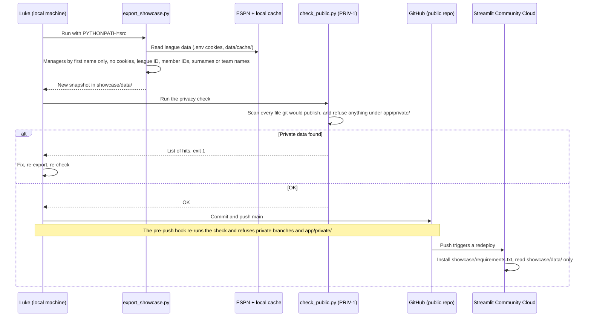

# SE-02 Concept of Operations

**Status: DRAFT.** AI-drafted by Claude on 2026-10-06 from the repository and its in-app SE page. Nothing here is reviewed by Luke yet.

This document describes how the system is used across a fantasy season. Behavior that the code already has is `IMPLEMENTED`; anything new is `PROPOSED`.

## 1. The scene

Luke manages one team in a 12-team ESPN head-to-head points league (26 rounds, weekly lineup lock). He wants a decision-support tool that recommends the draft pick with the best chance of winning weekly matchups, and every modelling claim behind it tested on the league's own history (SE page §1). The league's data sits behind Luke's ESPN login, and the repository is public. So the system runs as two deployments: a private research app on Luke's machine, and a public showcase built from a cleaned snapshot.

## 2. Actors and roles

The first four rows come from the SE page's stakeholder table. The rest were added by Claude (`PROPOSED`).

| Actor | Role | Needs | Sees private data? |
|---|---|---|---|
| **Fantasy manager** (Luke, primary user) | Drafts and manages one team | A clear, fast recommendation during a live draft; plain-language explanations | Yes |
| **Analyst / researcher** (Luke) | Runs experiments and checks assumptions | Reproducible experiments, honest statistics, a reusable framework | Yes |
| **League** (environment: the other 11 managers) | Sets the rules, rosters, schedule and opponent behavior the models must reflect | Not to be exposed by the public repo or site | — |
| **Data providers**: ESPN Fantasy API, MoneyPuck | Supply league, player and advanced-stat data | Rate limits respected; format changes and data-quality problems handled | ESPN holds the private league |
| **Public visitor** | Browses the showcase | A credential-free site that works on a phone | No |
| **Lab audience** | Hears the 10/14 talk | A short story: problem, method, verification, findings | No |
| **GitHub** (public repo) | Stores and publishes everything git tracks | — | Must never receive it |
| **Streamlit Community Cloud** | Hosts the showcase from the repo | No secrets (Secrets left empty) | No |

## 3. The two deployments

| | Private research app | Public showcase |
|---|---|---|
| Entry point | `app/streamlit_app.py` | `showcase/streamlit_app.py` |
| Runs on | Luke's machine | Streamlit Community Cloud (free; sleeps when idle, wakes in about half a minute) |
| Needs | `.env` with the ESPN cookies and league ID | Nothing. It reads only `showcase/data/`, makes no web requests and imports no `iknowpuck` code (R13) |
| Data | Live ESPN and MoneyPuck pulls, cached in `data/cache/`; experiment runs in `runs/` | The snapshot written by `scripts/export_showcase.py` (last export 10/2, week 1) |
| Pages | Walkthrough, League history, Graph spectral analysis, Assumption tests, Optimization, Theory tests, Systems engineering; plus Luke's private in-season pages where `app/private/` exists | History, Present, Future |
| Updated by | Running it; "Rebuild data and models" in the sidebar | The export → check → push loop (§6) |
| Status | `IMPLEMENTED` | `IMPLEMENTED`. Claude's notes say it deploys from `main` (OD-8) |

## 4. Season lifecycle

| Phase | When (2026-27) | Live tools | Not live |
|---|---|---|---|
| **Pre-draft** | Before 9/27 | Walkthrough, League history, Pre-draft plan, experiment suite (`python -m iknowpuck.experiments`), editable injury table | — |
| **Draft day** | 9/27 | Draft room: suggested pick from Monte Carlo rollouts with common random numbers, plus the paste-the-ESPN-log loader. ESPN's API showed no picks during the draft, so pasting was the working fallback. | — |
| **In-season** (now) | After the draft; tools archived 10/1 | Research app (7 pages); private in-season pages; public showcase | Draft room, Pre-draft plan, trade analyzer (archived, D-008); add/drop notifier (removed, D-009) |
| **Off-season** | After the season (dates not recorded) | `PROPOSED`: H5 re-test on 2027 data (G6); G3 re-fit and H2 re-run; H2b (G4); restore draft tools from `archive/` (G5) | — |

## 5. Use cases

| UC | Trigger | Actor | Tool | Outcome | Phase | Status |
|---|---|---|---|---|---|---|
| UC-1 | Luke wants to know who wins in this league and how | Manager | League history | Manager review, past drafts, pickups, injuries, head-to-head | any | `IMPLEMENTED` |
| UC-2 | A modelling assumption needs checking | Analyst | Assumption tests, Theory tests | Each assumption tested against the league's real results | any | `IMPLEMENTED` |
| UC-3 | A model or policy changes | Analyst | Experiment suite | New run in `runs/<id>/` with report, commit and seed; repeated with the other seed | any | `IMPLEMENTED` |
| UC-4 | Luke is on the clock in a live draft | Manager | Draft room | A suggested pick within the time limit (R6) | draft day | `IMPLEMENTED`, archived |
| UC-5 | A new week starts | Manager | Private in-season pages | Lineup and waiver advice for Luke's team (not described here) | in-season | `IMPLEMENTED`, private |
| UC-6 | The showcase is out of date | Luke | Export → check → push | Hosted site shows the new snapshot (§6) | in-season | `IMPLEMENTED` |
| UC-7 | A visitor opens the site | Public visitor | Showcase | History, Present, Future tabs, each with how it is built, the math and definitions | any | `IMPLEMENTED` |
| UC-8 | Lab meeting | Luke, lab audience | SE page outline + showcase | A talk cut to the time slot (OD-1) | 10/14 | `PROPOSED` |
| UC-9 | ESPN returns 401, or the cookies expire | Luke | `.env` | The error names the missing `.env` values; Luke re-copies the cookies | any | `IMPLEMENTED` |
| UC-10 | A cookie leaks | Luke | ESPN account | Sign out of ESPN on all devices, then put the new cookies in `.env` (README) | any | `IMPLEMENTED` (procedure) |

## 6. Example sequence: updating the public showcase (UC-6)

## 7. Assumptions and constraints

- One league, one manager. Scoring, lineup and lock rules come from ESPN's settings (METHODOLOGY §1, §4).
- History covers 2024–26 (3 drafts, 924 picks); the player panel covers 2018–2027.
- ESPN's read API can change and can show nothing during a live draft (FMEA row 2; `archive/README.md`).
- Only Luke's machine holds the cookies, so only Luke can refresh the snapshot.
- Free hosting: the showcase sleeps when idle.
- Side project: it ranks behind the thesis and coursework (SE-00).

---

**Explain-back (Luke):** Walk through UC-6. Where could private data slip into the public repo, and what catches it at each step? What would PRIV-1 miss?

>
